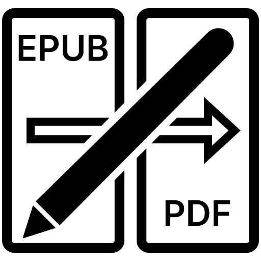

<p align="center">
  
</p>

<h1 align="center">Export EPUB to PDF</h1>

<p align="center">
  A Supernote plugin that exports the open EPUB to a PDF that looks exactly like it does on your Supernote,<br>
  with your handwritten notes, marker highlights and text highlights on top.
</p>

<p align="center">
  <b>Version 1.2.2</b> · Supernote Manta / Nomad · Chauvet 3.30+ · MIT licence
</p>

---

## Why

The Supernote can export annotated **PDFs**, but not annotated **EPUBs**. Handwriting on an EPUB is stored in a
separate `.mark` file tied to the page layout, so it never leaves the device. This plugin renders each page the way
the Supernote lays it out, draws your ink on top, and saves the result as a PDF.

## Features

- **Faithful pages** — the page is rendered by the Supernote itself: same layout, fonts and margins you read on.
- **Your real strokes** — each stroke is drawn from its actual outline, the same shape the screen shows.
  Marker strokes are drawn as a transparent wash, so the text underneath stays readable.
- **Text highlights** — highlights made with the text selection tool can be included or left out.
- **Choose the pages** — annotated pages only, the current page, a page range or the whole book.
  If the device has no index of annotated pages, the plugin finds the pages with ink by itself.
- **Small and safe** — greyscale PDF (like the screen), written to a private temporary file and only copied to
  `EXPORT` when complete. Cancel at any time: nothing half-written is left behind.
- **English and Spanish** — follows the system language.
- **Offline** — no network access, nothing is uploaded, no files are deleted.

## Install

1. Download `ExportEPUBtoPDF-x.y.z.snplg` from the [Releases](../../releases) page.
2. Connect the Supernote by USB (on macOS use [OpenMTP](https://openmtp.ganeshrvel.com/)) and copy the file to the
   **`MyStyle`** folder.
3. On the Supernote: **Settings › Apps › Plugins › Add Plugin**, then pick *Export EPUB to PDF*.

A newer version installs over the old one.

## Use

1. Open an EPUB.
2. Tap **Export to PDF** in the toolbar.
3. Choose the pages and tap **Export**. The first time, allow read and write access (choose *Always allow*).
4. The PDF is saved in **`EXPORT`** as `<book name> (annotated).pdf`.

## Permissions

| Permission | Why |
|---|---|
| `FILE:READ` | Read the annotations of the open book. |
| `FILE:WRITE` | Save the PDF in the `EXPORT` folder. |

The plugin only reads the open document, writes temporary files in its own private folder and writes one PDF in
`EXPORT`. It does not use the internet and does not delete any of your files.

## Limitations

- Output is greyscale, as on the Supernote screen: the device renders EPUB pages in grey, so colour illustrations
  come out grey (see *Roadmap*).
- Tested on a Manta with Chauvet 3.31.45. Older firmware without plugin support (before 3.29.43) will not run it.
- Pages are images at device resolution (about 226 dpi on a Manta); the text in the PDF is not selectable.

## How it works

For each page to export:

1. `PluginDocAPI.generateCurrentDocImage` renders the page as the Supernote lays it out.
2. `PluginFileAPI.getElements` returns the page's strokes; each stroke's outline (`contoursSrc`) is read.
3. A small native module (Kotlin) composites page and ink — markers multiplied, pens opaque on top — and appends
   the page to a PDF written by a minimal greyscale writer (8-bit, Flate, lossless).

| File | Role |
|---|---|
| `index.js` | Plugin entry: initialises the plugin and registers the toolbar button. |
| `App.tsx` | The dialog UI. |
| `src/exporter.js` | Export pipeline: permissions, page selection, rendering, ink. |
| `src/i18n.ts` | English and Spanish strings. |
| `android/app/src/main/java/com/epubpdfexport/EpubPdfRendererModule.kt` | Native compositing and file handling. |
| `android/app/src/main/java/com/epubpdfexport/GrayPdfWriter.kt` | Minimal greyscale PDF writer. |
| `PluginConfig.json` | Name, description, version, icon and permissions. |
| `tools/color-prototype/` | Prototype to restore EPUB colour illustrations (not in the plugin yet). |

## Build

Requirements: Node.js ≥ 18, JDK 17+, Android SDK Platform 35 and Build-Tools 35.0.0 (no NDK needed).
The project uses React Native **0.79.2** and `sn-plugin-lib` **0.2.3**, as required by the Supernote plugin host.

```bash
npm install
echo "sdk.dir=$HOME/Library/Android/sdk" > android/local.properties   # path to your Android SDK
./buildPlugin.sh
```

The package is written to `build/outputs/EpubPdfExport.snplg`. Check that the log says **"APK build succeeded"**:
if the native build fails, the script still produces a package without the native module, and that package
will not work.

`react-native.config.js` keeps `sn-plugin-lib` out of the native build, because the Supernote provides it at runtime.

See the official [Supernote plugin documentation](https://docs.supernote.com) for details.

## Roadmap

- **Restore EPUB colours** — the original colour images are inside the EPUB. A prototype
  (`tools/color-prototype`) finds them on the grey page and puts the colour back under the ink. It matched
  13 of 13 illustrated pages in a test book. To ship it, it needs porting to Kotlin and an RGB path in the PDF writer.

## Changelog

See [CHANGELOG.md](CHANGELOG.md).

## Licence

[MIT](LICENSE) © 2026 Gnaciux

---

## How this was made

I built this plugin together with [Claude](https://claude.ai), Anthropic's AI assistant.
Claude wrote most of the code following my direction: I defined what the plugin should do,
designed the logo and the interface, tested it on my Supernote and made the decisions along the way.
